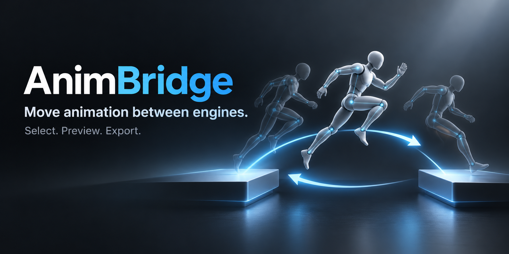

  

<h1 align="center">AnimBridge</h1>

<!-- readme-languages -->

[English](../README.md) · [Español](README.es.md) · [日本語](README.ja.md) · [한국어](README.ko.md) · [简体中文](README.zh-CN.md) · [繁體中文](README.zh-TW.md) · [Polski](README.pl.md) · [हिन्दी](README.hi.md) · [Русский](README.ru.md) · [العربية](README.ar.md) · [Português (Brasil)](README.pt-BR.md) · [Português (Portugal)](README.pt-PT.md) · **Français** · [ไทย](README.th.md) · [Türkçe](README.tr.md)

<!-- /readme-languages -->

Déplacez des animations entre Unity et Unreal Engine.
Déposez un paquet, choisissez les clips voulus et n'exportez que ceux-là.

Gratuit et open source · Windows x64

## Fonctionnalités

- **Déposez et inspectez.** Déposez un `.unitypackage`, un dossier, un `.anim` ou un `.fbx`, puis recherchez, filtrez et sélectionnez des clips.
- **Aperçu avant l'export.** Lisez d'abord n'importe quel clip dans l'application.
- **Original ou bake.** Extrayez les fichiers d'origine, ou faites un bake de l'animation évaluée vers FBX avec un squelette compatible.
- **Clips Humanoid et binaires.** Unity les évalue pour vous.
- **D'Unity à Unreal, et retour.** Outils d'importation dans Unreal et export FBX et manifeste vers Unity.
- **Local et natif.** Application hôte C++20 avec une interface WebView2 locale et des processus de conversion Python/Blender.
- **15 langues.** La langue choisie est enregistrée, avec une mise en page de droite à gauche pour l'arabe.
- **Gratuit pour toujours.** Licence MIT.

## Contribuer

[CONTRIBUTING.md](../CONTRIBUTING.md)

## Licence

[MIT](../LICENSE). Les composants tiers, comme Blender et WebView2, conservent leurs propres licences ; consultez les [mentions des composants tiers](../packaging/THIRD_PARTY_NOTICES.txt).
